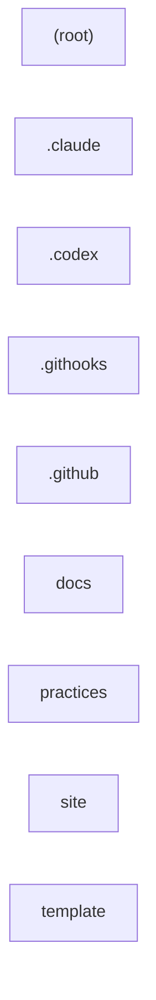

# Codebase map

Generated by [codebase-map](https://github.com/mogesjohnson/codebase-map). Edit freely outside the markers;
everything between them is regenerated on each run.

<!-- codebase-map:start -->
_Static map of **BEST-OF-AI-DEV**: 9 modules, 125 files._

## Module tree

```text
BEST-OF-AI-DEV/
├── (root files)  (10 files)
├── .claude/  (1 files)
├── .codex/  (1 files)
├── .githooks/  (3 files)
├── .github/  (9 files)
├── docs/  (28 files)
├── practices/  (3 files)
├── site/  (20 files)
└── template/  (50 files)
```

| Module | Purpose |
| --- | --- |
| `(root)` | Moges Johnson's template and source of truth for AI-first development: the practices worth keeping, drop-in agent rules for every new repo, and a docs site on why each practice matters. |
| `.claude` | Claude Code settings. |
| `.codex` | Codex CLI settings. |
| `.githooks` | Git hooks run by the repo (core.hooksPath). |
| `.github` | GitHub config: workflows, templates and ownership. |
| `docs` | Documentation. |
| `practices` | I reviewed my own repos to see which habits held up with agents writing most of the code and which ones didn't. |
| `site` | A static Next.js site that renders the Markdown pages in [../docs/why](../docs/why). |
| `template` | BEST-OF-AI-DEV template v1. |

## What each module owns

### `(root)`

- Entry points: scripts: `prepare`, `test`, `check:size`, `test:windows`
- Main exports: _none detected_

### `.claude`

- Entry points: _none detected_
- Main exports: _none detected_

### `.codex`

- Entry points: _none detected_
- Main exports: _none detected_

### `.githooks`

- Entry points: _none detected_
- Main exports: _none detected_

### `.github`

- Entry points: _none detected_
- Main exports: _none detected_

### `docs`

- Entry points: _none detected_
- Main exports: _none detected_

### `practices`

- Entry points: _none detected_
- Main exports: _none detected_

### `site`

- Entry points: scripts: `dev`, `build`, `lint`, `typecheck`
- Main exports: `default`, `nextConfig`, `metadata`, `RootLayout`, `Home`, `dynamicParams`, `generateStaticParams`, `generateMetadata`, `WhyPage`, `Article`, `Shell`, `THEME_KEY`, `THEME_SCRIPT`, `ThemeToggle`, `Toc`, `WHY_DIR`, `TocItem`, `Page`, `parseFrontMatter`, `localHref` and 10 more

### `template`

- Entry points: scripts: `prepare`, `test`
- Main exports: `TYPES`, `MAX_SUBJECT`, `EXEMPT`, `PR_EXEMPT`, `CLOSING`, `cleanMessage`, `checkSubject`, `checkMessage`, `hasLabel`, `checkerChanged`, `gate`, `SECTIONS`, `DEPENDABOT`, `REVERT_BODY`, `REVERT_COMMIT`, `isRevertPr`, `revertsBaseCommit`, `checkBody`, `parseLog`, `tighten` and 20 more

## Module dependencies



_No cross-module relative imports found._

## Risky files

Score combines git churn (45%), size in lines (35%) and fan-in, the number of other directories importing the file (20%).

| # | File | Score | Churn | Lines | Fan-in |
| --- | --- | --- | --- | --- | --- |
| 1 | `RULES.md` | 64 | 16 | 135 | 0 |
| 2 | `template/RULES.md` | 57 | 14 | 121 | 0 |
| 3 | `template/scripts/check/pr-size.mjs` | 47 | 5 | 179 | 1 |
| 4 | `template/scripts/test-windows.ps1` | 46 | 4 | 330 | 0 |
| 5 | `template/scripts/test/agent-config.test.mjs` | 45 | 9 | 141 | 0 |
| 6 | `template/scripts/check/pr-format.mjs` | 45 | 6 | 128 | 1 |
| 7 | `template/scripts/test/pr-format.test.mjs` | 42 | 8 | 144 | 0 |
| 8 | `template/scripts/check/secrets.mjs` | 42 | 5 | 124 | 1 |
| 9 | `site/src/app/globals.css` | 40 | 2 | 320 | 0 |
| 10 | `template/scripts/check/template-sync.mjs` | 40 | 5 | 110 | 1 |
| 11 | `AGENTS.md` | 40 | 10 | 71 | 0 |
| 12 | `template/scripts/cleanup-worktrees.ps1` | 36 | 4 | 194 | 0 |
| 13 | `.claude/settings.json` | 36 | 7 | 105 | 0 |
| 14 | `template/.claude/settings.json` | 36 | 7 | 105 | 0 |
| 15 | `template/scripts/check/commit-format.mjs` | 36 | 5 | 71 | 1 |

## Agent and context files

- `.claude/settings.json`
- `.codex/config.toml`
- `AGENTS.md`
- `CLAUDE.md`
- `GEMINI.md`
- `docs/agents.md`
- `template/.claude/settings.json`
- `template/.codex/config.toml`
- `template/AGENTS.md`
- `template/CLAUDE.md`
- `template/GEMINI.md`
- `template/docs/agents.md`
<!-- codebase-map:end -->
